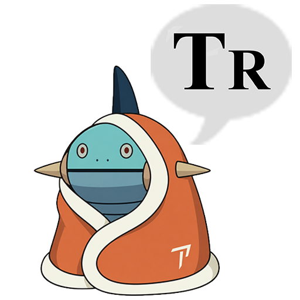

<p align="center">
  
</p>

# LabelPlus-Nondum

LabelPlus-Nondum 是一个 Photoshop 插件（UXP），用来把 LabelPlus 翻译稿嵌进漫画图片：一次生成整章 PSD，文字按 LabelPlus 的分组套用样式，居中进气泡，并可以把气泡里的原文涂白。

它杂交并魔改了 [TypeR](https://github.com/ScanR/TypeR) 和 [LabelPlus](https://github.com/LabelPlus/LabelPlus) 以及它的 [PS-Script](https://github.com/LabelPlus/PS-Script)以对接现有的被汉化组官方采用的基于Labelplus的汉化工作流。

## 功能

- **导入 LabelPlus 文本：** 读取 LabelPlus 导出的文本，自动找到图源文件夹并匹配图片。可以只选部分图片，支持按 Ctrl 或 Shift 多选、全选和全不选。
- **分组和样式：** 每个 LabelPlus 分组建一个图层组，每个分组单独选一个样式。文字一律是直排的点文本，并保留译者的换行。
- **气泡内居中：** 从标号点取样找到气泡，把文字放到气泡中心。尾巴不会把文字带偏，连体气泡会按标号点把文字分进各自的气泡室。文字放不下时不缩字号，超出气泡也保持居中。
- **涂白：** 把气泡连同原文一起填成气泡本身的颜色，涂在单独的 `LabelPlus Clean` 图层上。网点、渐变或灰色的气泡，以及里面还有别的气泡或画面的区域，不会被涂。
- **文本替换：** 可以勾选常用替换（如 `！？` 换成 `!?`），也能添加自己的替换规则。
- **主面板的 Align：** 选中一个或多个文字图层，按各自的中心点逐个居中进气泡。
- **样式：** 支持描边和全部图层样式（投影、内阴影、外发光等）。可以从选中的文字图层直接新建样式，也可以按文件夹整理、导入导出，与汉化组成员共享。
- **处理报告：** 每次运行后列出没有找到气泡、没有涂白等需要人工检查的地方。

## 安装

只支持 Windows：需要标准桌面版 Photoshop 2025（26.0）或更新版本；便携版、精简版可能删掉了插件支持，面板会打不开。可以和 TypeR 同时安装，但不要同时打开两个面板，否则每个快捷键都会执行两次。

### 一行命令安装

先关闭 Photoshop，在 PowerShell 里粘贴并回车：

```powershell
irm https://raw.githubusercontent.com/Dryiceee/LabelPlus-Nondum/main/get.ps1 | iex
```

脚本会下载最新版，校验后直接装进 Photoshop 的插件文件夹，不需要 Creative Cloud。装好后在“增效工具 > LabelPlus-Nondum”打开面板。

<details>
<summary><strong>离线安装包</strong></summary>

1. 下载 [`LabelPlus-Nondum.zip`](https://github.com/Dryiceee/LabelPlus-Nondum/releases/latest/download/LabelPlus-Nondum.zip) 并完整解压。
2. 关闭 Photoshop，双击 `install_win.cmd`。

解压后的文件夹建议留着，以后可以用它更新。

在命令提示符里可以给 `install_win.cmd` 加参数：

- `-Silent`：不等待按键，适合批量部署。
- 一个 `.ccx` 文件的路径：安装这个包，而不是离线包里自带的。
- `-PhotoshopPath "E:\My Photoshop"`：Photoshop 装在脚本找不到的位置时，告诉脚本它在哪里。脚本会顺便更新放在这个 Photoshop 的 `Plug-ins` 文件夹里的副本。

脚本只为当前用户安装，不需要管理员权限。它会先验证安装包里的每个文件，再替换旧版本；中途失败会自动恢复，其他插件的登记也不会动。

</details>

<details>
<summary><strong>用 Creative Cloud 安装</strong></summary>

下载 [`LabelPlus-Nondum-win.ccx`](https://github.com/Dryiceee/LabelPlus-Nondum/releases/latest/download/LabelPlus-Nondum-win.ccx)，双击后由 Creative Cloud 完成安装。

</details>

<details>
<summary><strong>手动放进 Photoshop 的 Plug-ins 文件夹</strong></summary>

适合脚本运行不了的电脑，例如公司电脑禁止运行脚本。

1. 下载 `.ccx` 安装包（见上一项），把后缀改成 `.zip` 后解压。
2. 把解压出来的文件夹改名为 `LabelPlus-Nondum`，放进 Photoshop 安装目录的 `Plug-ins` 文件夹。`manifest.json` 要直接位于 `LabelPlus-Nondum` 文件夹里，不能再套一层文件夹。
   一般是 `C:\Program Files\Adobe\Adobe Photoshop 2025\Plug-ins\`，写入这里需要管理员权限。
3. 重启 Photoshop。

这种方式只对放进去的那个 Photoshop 生效。更新时要换成新版本的文件夹，也可以运行安装脚本，它会一并更新这份副本。

</details>

### 更新

1.0.0 不会自动检查更新。有新版本时，关闭 Photoshop 后再运行一次上面的一行命令即可；用离线包的话，双击 `installer\update_win.cmd`；也可以下载新的 `.ccx` 双击安装。

样式和设置都会保留，它们存放在插件以外的位置：`%APPDATA%\LabelPlus-Nondum\UXP`。想另外备份，可以在“设置 > 数据”里导出。

## 使用

1. 点面板底部的 LabelPlus 按钮，打开导入窗口。
2. 选择 LabelPlus 导出的文本文件，确认图源文件夹和输出文件夹。
3. 在“分组和样式”里切换各个分组：选样式，并决定是否导入、是否居中、是否涂白。
4. 选择要处理的图片：
   - **生成 PSD：** 只放文字。
   - **处理整章：** 放文字，再居中和涂白。
   - **先在当前文档上试：** 对已经打开的文档试运行，不会保存。
5. 看处理报告，逐条检查列出的标号。

## 常见问题

<details>
<summary><strong>Photoshop 里找不到 LabelPlus-Nondum</strong></summary>

1. 关闭所有 Photoshop 窗口，重新运行安装脚本。如果用的是离线包，先把它完整解压。
2. 重启 Photoshop，在“增效工具 > LabelPlus-Nondum”里找。
3. 确认 Photoshop 是 2025（26.0）或更新的标准桌面版。

</details>

<details>
<summary><strong>面板打开后是空白的</strong></summary>

插件的界面显示在 Photoshop 的网页组件（UXP WebView）里。网页组件 15 秒内没有响应时，面板会显示一段诊断信息，请把它连同 Photoshop 版本一起发到 issues。

可能是 Adobe 自带的 WebView2 组件缺失或损坏，常见于不完整的 Photoshop 安装。它位于 `C:\Program Files\Common Files\Adobe\Microsoft\EdgeWebView\`。这时要修复 Photoshop 的安装，只重装插件解决不了。参见 [Adobe 的 UXP WebView 说明](https://helpx.adobe.com/creative-cloud/apps/integration-with-other-apps/manage-plugins/uxp-webview.html)。

</details>

<details>

## 从源码构建

```bash
npm install
npm test
npm run package:release
```

安装包会生成在 `Releases/` 文件夹里。开发时可以用 `npm run build:uxp` 生成 `uxp/` 文件夹，再用 UXP Developer Tools 加载其中的 `manifest.json`。

## 许可证与致谢

本项目以 GNU GPL 第 2 版发布，详见 [LICENSE.md](LICENSE.md)。

- [TypeR](https://github.com/ScanR/TypeR)，作者 Sakushi 和 SeanR（基于 Swirt 的 TypeR tools），MIT 许可证
- [LabelPlus](https://github.com/LabelPlus/LabelPlus) 和 [PS-Script](https://github.com/LabelPlus/PS-Script)，GNU GPL 第 2 版
- [hyphen](https://github.com/ytiurin/hyphen)，作者 Yevhen Tiurin，ISC 许可证
