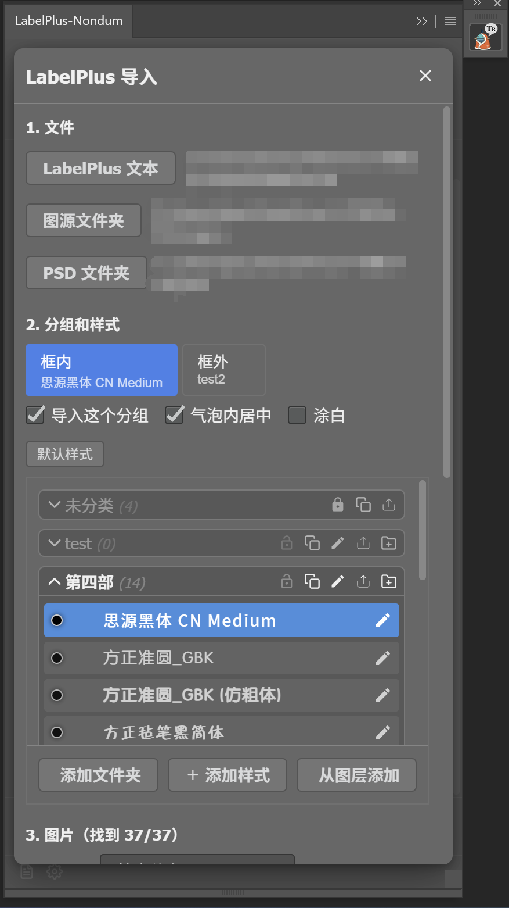
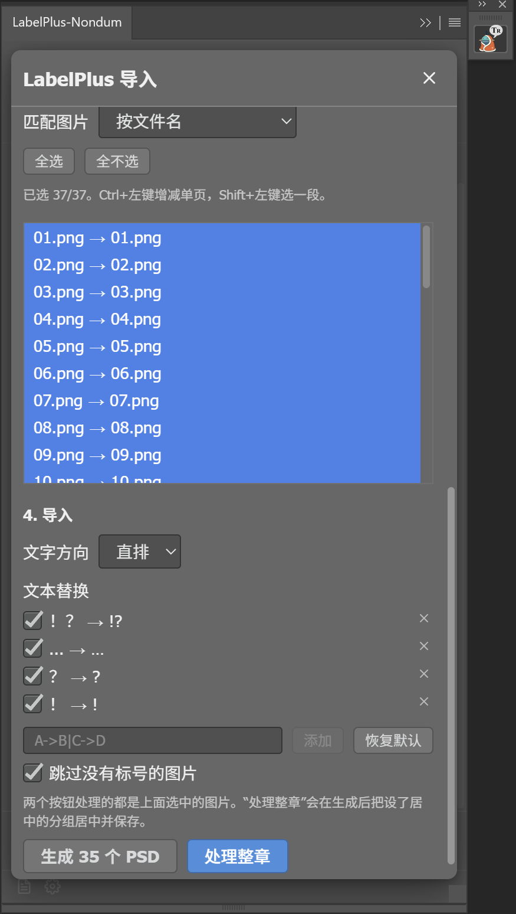
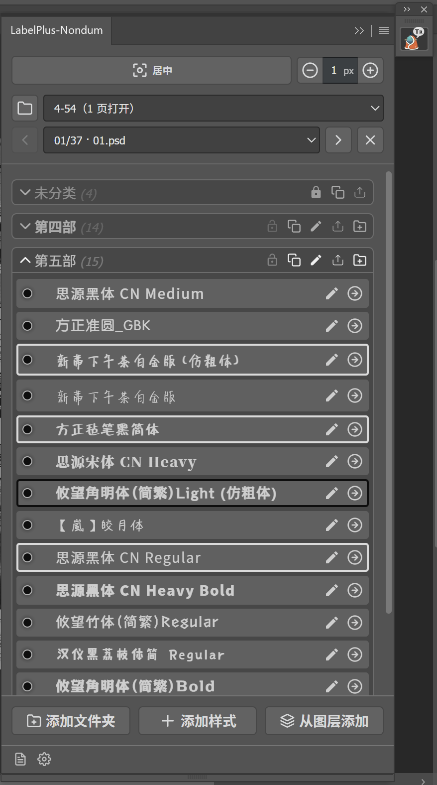
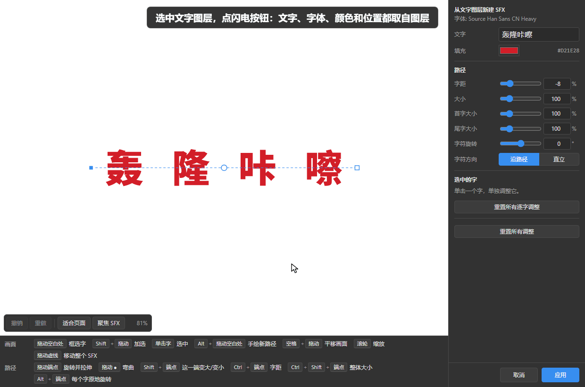

<p align="center">
  
</p>

# LabelPlus-Nondum

LabelPlus-Nondum 是一个 Photoshop 插件（UXP），用来把 LabelPlus 翻译稿嵌进漫画图片：一次生成整章 PSD，文字按 LabelPlus 的分组套用样式，居中进气泡，并可以把气泡里的原文涂白。

它杂交并魔改了 [TypeR](https://github.com/ScanR/TypeR) 和 [LabelPlus](https://github.com/LabelPlus/LabelPlus) 的 [PS-Script](https://github.com/LabelPlus/PS-Script)以对接现有的被汉化组广泛采用的基于Labelplus的汉化工作流。

> **使用要求：** 只支持 Windows，需要标准桌面版 **Photoshop 2025（26.0）或更新版本**。

## 功能

- **导入 LabelPlus 文本：** 读取 LabelPlus 导出的文本，自动找到图源文件夹并匹配图片。可以只选部分图片，支持按 Ctrl 或 Shift 多选、全选和全不选。
- **分组和样式：** 每个 LabelPlus 分组建一个图层组，每个分组单独选一个样式。文字一律是直排的点文本，并保留译者的换行。
- **气泡内居中：** 从标号点取样找到气泡，把文字放到气泡中心。尾巴不会把文字带偏，连体气泡会按标号点把文字分进各自的气泡室。文字放不下时不缩字号，超出气泡也保持居中。
- **涂白：** 把气泡连同原文一起填成气泡本身的颜色，涂在单独的 `LabelPlus Clean` 图层上。网点、渐变或灰色的气泡，以及里面还有别的气泡或画面的区域，不会被涂。
- **文本替换：** 可以勾选常用替换（如 `！？` 换成 `!?`），也能添加自己的替换规则。
- **主面板的 Align：** 选中一个或多个文字图层，按各自的中心点逐个居中进气泡。往选区里常规粘贴新文字后也可以自动居中，在“设置 > 常规 > 居中”里选择气泡内居中或多气泡居中。
- **翻页条：** 在 Align 下方打开一个放 PSD 的文件夹（上次 LabelPlus 导入的，或任意文件夹），用 ◀ ▶、页码列表或快捷键翻页。翻页时会保存离开的那一页并让它保持打开，历史记录不会丢。打开的页数超过上限（所有项目合计，默认 20 页）时，会自动保存并关闭最久没看过的一页，提前 5 页提醒。可以同时开几个项目，最近用过的列在“过往项目”里。
- **SFX 拟声字编辑器：** 把选中的中文文字图层排成拟声字：沿直线、弧线或手绘路径排列（拖动端点可在选中的字处弯折），调字距、旋转和首尾大小，也能逐字拖动、旋转、缩放，或像 Photoshop 的自由变换那样拉伸、变形单个字。应用后生成一个 Photoshop 原生形状图层，字形取自 Photoshop 对源字体生成的轮廓，「回」「器」这类字的内孔都保留。填充色和锚点可以直接在 Photoshop 里改，设置随 PSD 保存，之后选中这个图层还能再进编辑器调整。
- **行间注（Ruby）：** 给选中文字图层里的几个字加注释（Ruby）。直排文字注在右侧，横排注在上方，注释用原文的字体、颜色和图层样式。注释比字长时可以缩小字号（默认）、压扁、伸出或撑开原文；需要时会自动加大原文行距，免得注释撞上相邻的列。生成一个图层组，原文改过后可以「重新对齐」。
- **样式：** 支持描边和全部图层样式（投影、内阴影、外发光等）。可以从选中的文字图层直接新建样式（界面为中文时以字体的中文名命名），也可以按文件夹整理、导入导出，与汉化组成员共享。新建的样式默认打开「标准垂直罗马对齐方式」，竖排时英文字母、数字和 ?! 保持直立，可在样式编辑窗口里关掉。
- **处理报告：** 每次运行后列出没有找到气泡、没有涂白等需要人工检查的地方。

## 安装

只支持 Windows：需要标准桌面版 Photoshop 2025（26.0）或更新版本；便携版、精简版可能删掉了插件支持，面板会打不开。可以和 TypeR 同时安装，但不要同时打开两个面板，否则每个快捷键都会执行两次。

### 一行命令安装

先关闭 Photoshop，在 PowerShell 里粘贴并回车：

```powershell
irm https://raw.githubusercontent.com/Dryiceee/LabelPlus-Nondum/main/get.ps1 | iex
```

脚本会下载最新版，校验后直接装进 Photoshop 的插件文件夹，不需要 Creative Cloud。装好后在“增效工具 > LabelPlus-Nondum”打开面板。

<details>
<summary><strong>离线安装包</strong></summary>

1. 下载 [`LabelPlus-Nondum.zip`](https://github.com/Dryiceee/LabelPlus-Nondum/releases/latest/download/LabelPlus-Nondum.zip) 并完整解压。
2. 关闭 Photoshop，双击 `install_win.cmd`。

解压后的文件夹建议留着，以后可以用它更新。

在命令提示符里可以给 `install_win.cmd` 加参数：

- `-Silent`：不等待按键，适合批量部署。
- 一个 `.ccx` 文件的路径：安装这个包，而不是离线包里自带的。
- `-PhotoshopPath "E:\My Photoshop"`：Photoshop 装在脚本找不到的位置时，告诉脚本它在哪里。脚本会顺便更新放在这个 Photoshop 的 `Plug-ins` 文件夹里的副本。

脚本只为当前用户安装，不需要管理员权限。它会先验证安装包里的每个文件，再替换旧版本；中途失败会自动恢复，其他插件的登记也不会动。

</details>

<details>
<summary><strong>用 Creative Cloud 安装</strong></summary>

下载 [`LabelPlus-Nondum-win.ccx`](https://github.com/Dryiceee/LabelPlus-Nondum/releases/latest/download/LabelPlus-Nondum-win.ccx)，双击后由 Creative Cloud 完成安装。

</details>

<details>
<summary><strong>手动放进 Photoshop 的 Plug-ins 文件夹</strong></summary>

适合脚本运行不了的电脑，例如公司电脑禁止运行脚本。

1. 下载 `.ccx` 安装包（见上一项），把后缀改成 `.zip` 后解压。
2. 把解压出来的文件夹改名为 `LabelPlus-Nondum`，放进 Photoshop 安装目录的 `Plug-ins` 文件夹。`manifest.json` 要直接位于 `LabelPlus-Nondum` 文件夹里，不能再套一层文件夹。
   一般是 `C:\Program Files\Adobe\Adobe Photoshop 2025\Plug-ins\`，写入这里需要管理员权限。
3. 重启 Photoshop。

这种方式只对放进去的那个 Photoshop 生效。更新时要换成新版本的文件夹，也可以运行安装脚本，它会一并更新这份副本。

</details>

### 更新

从 1.1.0 起，面板每天最多检查一次新版本。有新版本时会弹窗，可以直接安装、去 GitHub 手动下载，或跳过这个版本。安装后面板一般会自动重新加载；如果没有，重启 Photoshop 后生效。

更新的选项在“设置 > 常规 > 更新”里：

- **自动检查更新**：默认打开，关掉后不再提示。
- **自动安装更新**：默认关闭，打开后新版本会在后台直接安装。
- **检查更新**按钮：随时手动检查一次。

1.0.0 不会检查更新，需要手动更新一次。关闭 Photoshop 后再运行一次上面的一行命令；用离线包的话，双击 `installer\update_win.cmd`；也可以下载新的 `.ccx` 双击安装。以后想手动更新，也可以用这些方法。

样式和设置都会保留，它们存放在插件以外的位置：`%APPDATA%\LabelPlus-Nondum\UXP`。想另外备份，可以在“设置 > 数据”里导出。

## 使用

<p align="center">
  
  
</p>

1. 点面板底部的 LabelPlus 按钮，打开导入窗口。
2. 选择 LabelPlus 导出的文本文件，确认图源文件夹和输出文件夹。
3. 在“分组和样式”里切换各个分组：选样式，并决定是否导入、是否居中、是否涂白。
4. 选择要处理的图片：
   - **生成 PSD：** 只放文字。
   - **处理整章：** 放文字，再居中和涂白。
5. 看处理报告，逐条检查列出的标号。
6. 导入完成后，输出文件夹会在 Align 下方的翻页条里打开第一页。不想自动打开，可以在“设置 > 常规 > 翻页”里关掉；最多同时打开的页数也在这里改。

   

如果导入要覆盖的 PSD 正在 Photoshop 里打开，会先询问，再不保存地关闭它们。

### SFX 编辑器

演示依次是：拖端点旋转拉伸，拖 ● 弯曲，Shift+拖端点放大尾字，Alt+拖端点让每个字原地旋转，单独旋转、移动一个字，框选两个字后拖 ◆ 只弯这一段，拖控制柄调成 S 形，最后点「应用」。



1. 用文字工具打好拟声字（如「轰隆」），选中这个文字图层，点面板底部的闪电按钮（SFX 编辑器）。
2. 窗口里显示当前页面，文字、字体、字号、颜色和位置都取自选中的图层。
3. 排字：
   - 拖动路径两端的方块：旋转并拉伸；按住 Shift 拖动：放大或缩小这一端的字；按住 Ctrl：调字距；按住 Ctrl+Shift：整体缩放。拖动中间的 ●：弯成弧线。按住 Alt 在空白处拖动：手绘一条新路径。
   - 拖动空白处框选字，单击一个字选中它，Shift 加选。选中后拖动移动。只选一个字时显示自由变换框：拖动角点或边点拉伸，按住 Shift 拖动角点从中心等比缩放，按住 Ctrl 拖动角点变形、拖动边点斜切，在角点外侧拖动旋转。选中多个字时，拖动上方的 ● 旋转，拖动角上的方块一起缩放。拖动选区中间的 ◆ 只弯曲选中的这一段；拖动端点会在选区开头弯折路径，只有选中的这段跟着走。弯折处会加一个贝塞尔锚点（画面上的小方点），之前的弯曲都会保留。单击小方点显示它两侧的控制柄，拖动控制柄调曲线（两个控制柄往相反方向拉就是 S 形），按住 Alt 只动一侧；拖动小方点移动锚点。只改路径形状时，改动段以外的字不会动。方向键、`[` `]`、`+` `-` 也能微调，Tab 切换到下一个字。
   - 拖动虚线移动整个 SFX（虚线压在字上时也是拖虚线；只单击不拖动则选中线下的字）。滚轮上下移动画面，Ctrl+滚轮左右移动，Alt+滚轮缩放；按住空格拖动也能平移画面。
4. 点「应用」：源文字图层在原位置换成一个形状图层，整个拟声字都在它的矢量蒙版里。Ctrl+Z 一次就能连图层替换一起撤销；点「取消」文档不变。
5. 以后选中这个形状图层再点 SFX 编辑器，可以继续调整，「应用」会更新同一个图层。在 Photoshop 里移动过图层，编辑器会跟着新位置；手动改过锚点的话，编辑器会提示「应用」将按设置重建路径。

### 行间注

1. 选中一个点文本的文字图层（直排或横排都行），点面板底部 SFX 按钮旁边的行间注按钮。
2. 在左侧画面里拖选要注释的字，右侧会多出一条注释，填入注释文字。一条注释不能跨行或跨列。
3. 每条注释可以调：
   - **对齐：** 均分（默认）、居中、顶端（横排为左端）。
   - **均分方式**（对齐选均分时）：1-2-1（默认，两端各留半格、字间一格）或 0-1-0（两端顶格，空隙只放在字间）。
   - **过长时：** 缩小字号（默认）、压扁注释、伸出、撑开原文。
   - **字号**（留空为自动）、大小比例、和原文的间距。
4. 点「应用」：原文图层和注释图层放进一个「行间注：」图层组，算作一个历史记录步骤。注释的设置随 PSD 保存。
5. 以后改了原文或移动过图层，选中这个组（或其中任意图层）再点行间注按钮，会按当前文字重新对齐，再点「应用」就更新好了。

段落文本、变形文字和旋转过的文字图层暂不支持。

## 常见问题

<details>
<summary><strong>Photoshop 里找不到 LabelPlus-Nondum</strong></summary>

1. 关闭所有 Photoshop 窗口，重新运行安装脚本。如果用的是离线包，先把它完整解压。
2. 重启 Photoshop，在“增效工具 > LabelPlus-Nondum”里找。
3. 确认 Photoshop 是 2025（26.0）或更新的标准桌面版。

</details>

<details>
<summary><strong>面板打开后是空白的</strong></summary>

插件的界面显示在 Photoshop 的网页组件（UXP WebView）里。网页组件 15 秒内没有响应时，面板会显示一段诊断信息，请把它连同 Photoshop 版本一起发到 issues。

可能是 Adobe 自带的 WebView2 组件缺失或损坏，常见于不完整的 Photoshop 安装。它位于 `C:\Program Files\Common Files\Adobe\Microsoft\EdgeWebView\`。这时要修复 Photoshop 的安装，只重装插件解决不了。参见 [Adobe 的 UXP WebView 说明](https://helpx.adobe.com/creative-cloud/apps/integration-with-other-apps/manage-plugins/uxp-webview.html)。

</details>

## 从源码构建

```bash
npm install
npm test
npm run package:release
```

安装包会生成在 `Releases/` 文件夹里。

## 许可证与致谢

本项目以 GNU GPL 第 2 版发布，详见 [LICENSE.md](LICENSE.md)。

- [TypeR](https://github.com/ScanR/TypeR)，作者 Sakushi 和 SeanR（基于 Swirt 的 TypeR tools），MIT 许可证
- [LabelPlus](https://github.com/LabelPlus/LabelPlus) 和 [PS-Script](https://github.com/LabelPlus/PS-Script)，GNU GPL 第 2 版
